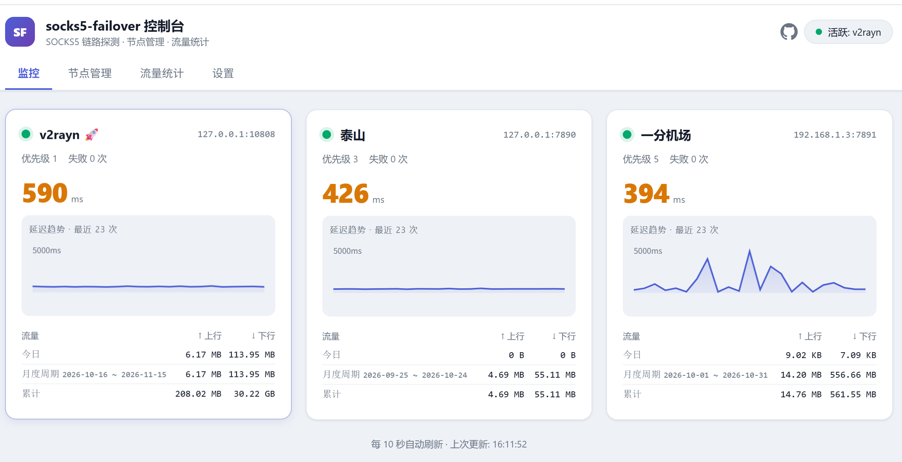
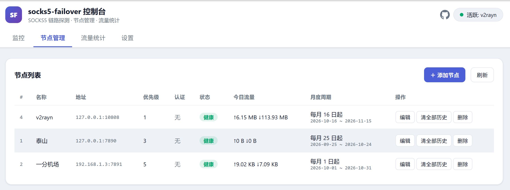
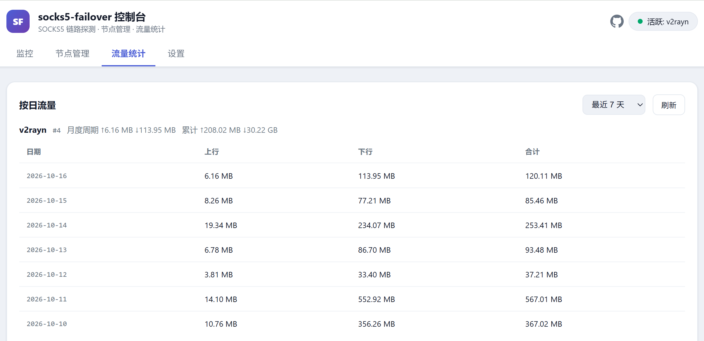
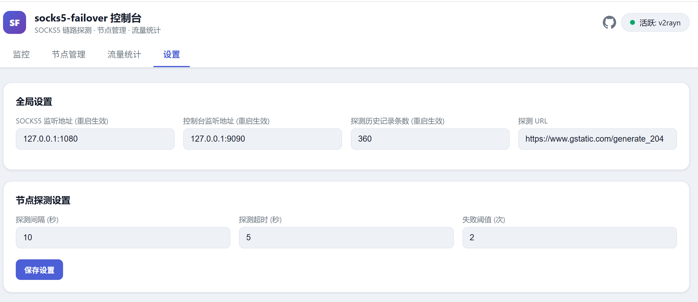

# socks5-failover

轻量、高性能的 SOCKS5 代理路由与故障转移（Failover）中间件。

对本地应用暴露一个固定的 SOCKS5 代理入口（如 `127.0.0.1:1080`），后端支持挂载多个不同优先级的上游代理节点（如本地 Clash/V2Ray 端口、局域网代理、机场等）。通过**多层健康探测**与**故障快速切断（Fast Failover & Fast Kill）**，保障网络长效稳定、无感容灾。

**监控**：



**节点管理**：



**流量统计**：



**设置**：



---

## 核心特性

- **节点优先级路由**：支持设置节点优先级（`priority` 数值越小优先级越高），自动维持高优先级节点作为主用线路。
- **双重健康探测机制**：
  - **主动定期探针**：周期性通过各上游向目标测试地址（默认 `https://www.google.com/generate_204`）发起真实 HTTP 请求，连续失败达到阈值即自动下线该节点；节点恢复后自动回切。
  - **被动即时剔除**：客户端建立连接遇到 TCP 拨号失败时，瞬间标记故障并无缝重试下一个候选节点，减少请求挂起。
- **长连接故障主动熔断（Fast Kill）**：当节点故障下线时，主动清理断开该节点名下的存量悬挂长连接，促使客户端（浏览器、聊天软件等）迅速触发重连，避免长时间无响应卡死。
- **长连接保活优化**：开启 TCP Keepalive 探测机制（默认 30s），防止中间网络链路静默断开。
- **SQLite 配置存储**：全局参数、节点列表、流量统计统一存储在 `socks5-failover.db`，通过页面或 API 在线修改，热生效、重启不丢。
- **远程 API 配置**：无浏览器环境（如服务器）可直接用 curl/HTTP 客户端完成全部配置管理。
- **流量统计**：按节点、按日统计上/下行字节数（每 30s 落库聚合）；支持每节点独立配置**月度周期起始日**（`billing_day`，如每月 5 日起算），月度用量基于每日记录实时汇总，历史永不回改；支持一键清除全部历史（带二次确认）。
- **管理控制台**：内置轻量 HTTP 服务，`/` 提供四视图控制台（监控仪表盘 / 节点管理 / 流量统计 / 全局设置），`/api/*` 提供全部数据与管理接口。
- **探测历史环形缓冲区**：延迟历史采用固定容量（`history_size`，默认 360 次 ≈ 1 小时）的环形缓冲区存储，超出容量自动覆盖最旧数据，**长期运行内存恒定无泄漏**。
- **开箱即用**：自带 Windows 后台静默启动/停止脚本（`start.vbs` / `stop.vbs`），无黑窗口干扰。

---

## 目录结构

```text
socks5-failover/
├── main.go           # 核心服务：SOCKS5 透传、健康探测、故障转移、流量插桩
├── store.go          # SQLite 存储层（settings / upstreams / traffic_daily）
├── api.go            # 管理与监控 HTTP API
├── dashboard.go      # 内嵌 Web 管理控制台
├── go.mod / go.sum   # Go 模块依赖文件（module socks5-failover）
├── .github/workflows/release.yml  # GitHub Actions 五平台 Release 构建
├── build.bat         # Windows 本地构建脚本（产物进 dist/）
├── build.sh          # Linux / macOS 本地构建脚本（产物进 dist/）
├── start.vbs         # Windows 静默后台启动脚本（拉起 dist/ 下的产物）
├── stop.vbs          # Windows 静默后台停止脚本
├── dist/             # 本地构建产物输出目录（已 gitignore，不入库）
├── socks5-failover.db  # 运行时数据库（位于进程工作目录，首次启动自动创建，勿提交）
├── image/            # README 界面截图
├── .gitignore        # 忽略规则
├── .gitattributes    # 脚本类文件的换行符约定
└── README.md         # 项目说明文档
```

首次启动时自动建库并写入内置默认参数；节点列表为空，通过页面或 API 添加即可。

> 数据库路径为相对路径（`socks5-failover.db`），实际位置取决于进程的**工作目录**。在不同目录下运行会各自建库，请固定从一个目录启动。

---

## 快速开始

### 1. 获取程序

**方式 A：从 GitHub Release 下载（推荐）**

前往 [Releases](https://github.com/goodryb/socks5-failover/releases/latest) 下载对应平台的产物 `socks5-failover-<os>-<arch>`：

| 平台 | 产物 |
| :--- | :--- |
| Linux x86_64 | `socks5-failover-linux-amd64` |
| Linux ARM64（树莓派等） | `socks5-failover-linux-arm64` |
| macOS Intel | `socks5-failover-darwin-amd64` |
| macOS Apple Silicon | `socks5-failover-darwin-arm64` |
| Windows | `socks5-failover-windows-amd64.exe` |

全部产物由 GitHub Actions 以 `CGO_ENABLED=0` 静态编译，无运行库依赖；每个产物附 `.sha256` 校验文件。下载后即可直接运行：

- **Linux / macOS**：赋予执行权限后启动
  ```bash
  chmod +x socks5-failover-linux-amd64
  ./socks5-failover-linux-amd64
  ```
- **Windows**：直接双击 `socks5-failover-windows-amd64.exe`，弹出的控制台窗口会实时输出日志。数据库会建在 exe 所在目录，建议先把 exe 放入独立目录（如 `C:\socks5-failover\`）再运行；首次运行如遇 SmartScreen 拦截（产物未做代码签名），点「更多信息」→「仍要运行」即可。

**方式 B：本地构建**

要求已安装 Go 1.27+ 环境（与 `go.mod` 的 `go` 声明一致）。项目提供了两个构建脚本，执行前先跑 `go vet`，产物统一输出到 `dist/`：

| 系统 | 仅当前平台 | 交叉编译 5 个平台 |
| :--- | :--- | :--- |
| Windows | `build.bat` | `build.bat all` |
| Linux / macOS | `./build.sh` | `./build.sh all` |

不带参数时产出 `dist/socks5-failover`（Windows 为 `dist\socks5-failover.exe`，与 `start.vbs` 对应）；
带 `all` 时产出与 Release 同名的 `dist/socks5-failover-<os>-<arch>[.exe]`（linux/amd64、linux/arm64、darwin/amd64、darwin/arm64、windows/amd64）。

脚本等价的原始命令（`CGO_ENABLED=0` 保证纯 Go 静态链接）：

```bash
CGO_ENABLED=0 go build -trimpath -ldflags "-s -w" -o dist/socks5-failover .
```

构建完成后在项目根目录运行产物：

- **前台控制台运行**（便于查看实时输出日志，在项目根目录执行以保持数据库位置一致）：
  ```bash
  ./dist/socks5-failover        # Linux / macOS
  ```
  ```bat
  dist\socks5-failover.exe      # Windows
  ```

- **Windows 后台静默启动**：双击 `start.vbs`，脚本会把工作目录锁到项目根目录后静默拉起 `dist\socks5-failover.exe`，无命令行窗口。

- **Windows 后台静默停止**：双击 `stop.vbs`（按映像名 `taskkill`，同样不弹窗）。由于流量增量每 30 秒已落库并回收 WAL，强制结束最多丢失 30 秒统计，不会损坏数据库。可用任务管理器或 `127.0.0.1:9090` 是否还能访问确认已停。

### 2. 配置客户端

将浏览器、Telegram、IDE 或系统全局代理的 **SOCKS5 代理** 设置为：
- **主机**：`127.0.0.1`
- **端口**：`1080`（以数据库中 `listen` 配置为准）

---

## Web 管理控制台

访问 `http://127.0.0.1:9090/`，包含四个视图：

| 视图 | 功能 |
| :--- | :--- |
| 监控 | 各节点健康图标、实时延迟、延迟趋势折线图、今日/月度周期/累计流量，每 10 秒自动刷新 |
| 节点管理 | 节点增删改、优先级调整、启用/禁用、月度周期起始日设置、清全部历史（自定义二次确认框展示影响范围） |
| 流量统计 | 按月度周期或按日（7/14/30/90 天）展示各节点上/下行流量 |
| 设置 | 监听地址、探测参数、测试 URL 在线修改 |

---

## HTTP 配置 API（无浏览器场景）

所有接口挂在监控端口（默认 `127.0.0.1:9090`）上：

| 方法 | 路径 | 说明 |
| :--- | :--- | :--- |
| GET | `/api/status` | 节点实时状态 + 延迟历史 + 流量（供仪表盘与第三方监控） |
| GET | `/api/settings` | 读取全局设置 |
| PUT | `/api/settings` | 局部更新设置，仅处理请求体中出现的键 |
| GET | `/api/upstreams` | 节点列表（含 `billing_day` 月度周期起始日） |
| POST | `/api/upstreams` | 新增节点（`name`、`addr` 必填，`billing_day` 可选，默认 1） |
| PUT | `/api/upstreams/{id}` | 更新节点（局部字段覆盖，含 `billing_day`） |
| DELETE | `/api/upstreams/{id}` | 删除节点（连带清除其流量历史） |
| GET | `/api/traffic?days=7` | 按日流量统计（1~3660 天），附各节点月度周期合计 |
| GET | `/api/traffic?period=cycle` | 按各节点自身月度周期区间统计 |
| POST | `/api/upstreams/{id}/reset-traffic` | 清除指定节点全部流量历史 |

### 示例

```bash
# 添加节点
curl -X POST http://127.0.0.1:9090/api/upstreams \
  -H 'Content-Type: application/json' \
  -d '{"name":"主代理","addr":"127.0.0.1:7890","priority":1,"enabled":true}'

# 设置节点月度周期起始日为每月 5 号
curl -X PUT http://127.0.0.1:9090/api/upstreams/1 \
  -H 'Content-Type: application/json' \
  -d '{"billing_day":5}'

# 修改探测间隔、测试 URL
curl -X PUT http://127.0.0.1:9090/api/settings \
  -H 'Content-Type: application/json' \
  -d '{"check_interval":15,"test_url":"https://www.google.com/generate_204"}'

# 清除节点全部流量历史
curl -X POST http://127.0.0.1:9090/api/upstreams/1/reset-traffic
```

### 安全提示

管理 API 本身**无鉴权**，默认仅监听 `127.0.0.1`，只有本机能访问。若将 `status_listen` 改为 `0.0.0.0` 对外开放，请自行通过防火墙白名单、反向代理或 SSH 隧道限制访问来源——能调用该接口即等于能改写上流节点、劫持代理流量。

### 设置项说明

| 字段 | 说明 | 生效方式 |
| :--- | :--- | :--- |
| `listen` | 本地 SOCKS5 监听地址 | 重启 |
| `status_listen` | 管理/监控 HTTP 监听地址 | 重启 |
| `check_interval` | 主动探针间隔（秒） | 即时 |
| `check_timeout` | 探针超时（秒） | 即时 |
| `fail_threshold` | 判定故障的连续失败次数 | 即时 |
| `history_size` | 每节点延迟历史环形缓冲容量 | 重启 |
| `test_url` | 探针测试 URL（200/204 视为正常） | 即时 |

---

## 流量统计

- 双向透传路径上逐块计数：`上行` = 客户端 → 上游，`下行` = 上游 → 客户端。
- 计数先累加在节点内存中，每 30 秒合并写入 SQLite `traffic_daily` 表（按节点 + 本地日期聚合），进程被强杀最多丢失 30 秒增量。
- 查询接口会自动把未落库的内存增量并入当日数据。
- **月度周期**：每个节点可独立设置起始日 `billing_day`（1~31，默认每月 1 日）。起始日大于当月天数时自动按月末计算（如设 31 日，9 月从 30 日起算、10 月从 31 日起算）。
- 月度值不单独存储，始终基于每日记录在周期区间内实时求和——修改起始日只影响之后的窗口，**历史数据永不回改**。
- 「清全部历史」会删除该节点全部每日流量记录（含内存未落库增量），页面带自定义二次确认框展示影响范围；不影响探测延迟历史与健康状态。

---

## 节点故障与切换逻辑

1. **主节点异常（降级故障转移）**：
   - 当探测失败达到 `fail_threshold` 或实时 TCP 拨号失败时，立即标记主节点为不可用。
   - **立即切断（Fast Kill）**：主动断开主节点名下的所有存量长连接，迫使客户端（浏览器、Git、聊天工具等）立刻收到连接中断信号并触发自身的重连逻辑，避免长连接挂死假死。
   - 自动切换到当前可用的最高优先级备用节点接管新请求。
2. **主节点恢复（健康回切 Failback）**：
   - 后台探针检测到高优先级节点恢复健康后，自动将活跃工作节点切回主节点。
   - **平滑过渡（防闪断机制）**：
     - **新建立的连接**：立即路由至恢复的高优主节点。
     - **备用节点上的存量长连接**：继续维持直至其自然结束（如用户主动关闭页面或请求结束），避免回切造成正在进行的下载、长会话被强制打断。

---

## License

本项目基于 [MIT License](LICENSE) 开源。
